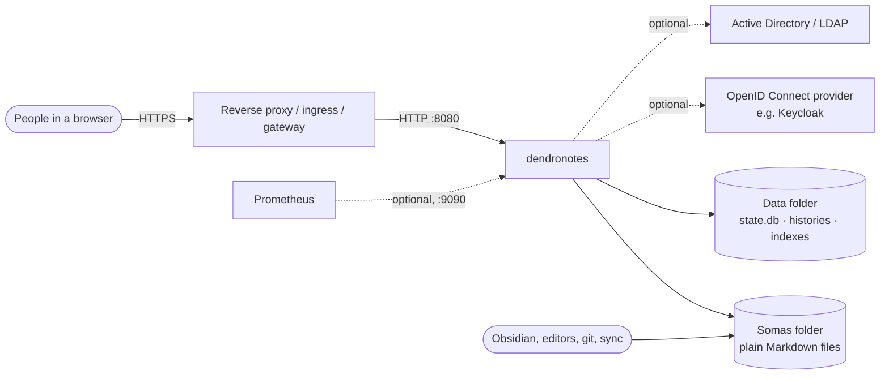
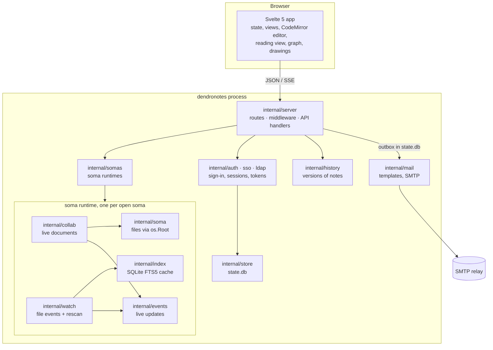
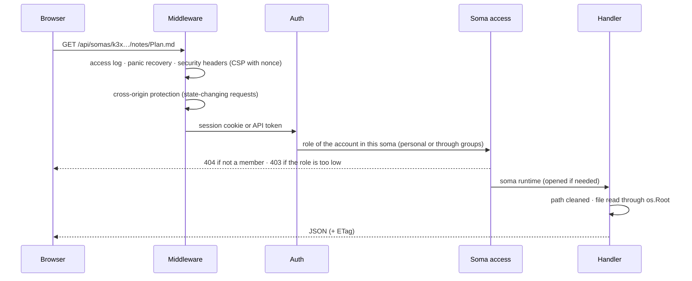
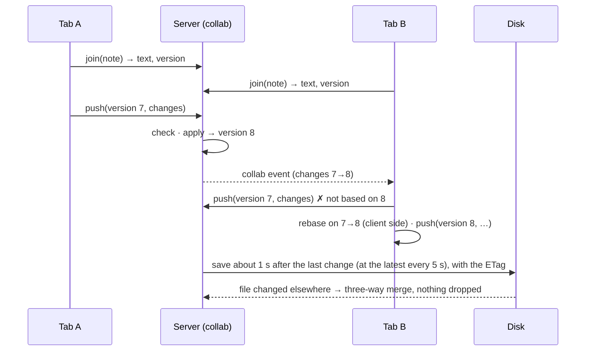

# Architecture

This document describes how dendronotes is built: its parts, where data lives, how a request is
handled, how people edit together, and the decisions behind it. For using and running it see
the [user guide](guide.md) and [installation](installation.md).

## Goals and constraints

- **The notes stay plain files.** A soma is a folder of Markdown files that stays readable and
  editable with any other tool: Obsidian, an editor, git, a sync tool. dendronotes adds no
  syntax, no front matter and no sidecar files; everything it knows beyond the files lives in its
  own data folder.
- **One process, no external services.** A single Go binary with the web interface built in.
  SQLite (pure Go) for state and search; no database server, no message broker, no cache.
- **No external requests.** No CDNs, fonts or telemetry; images from other hosts are never
  loaded. It runs in an air gap.
- **Several people at once.** Accounts, sharing with roles, editing the same note together in
  real time, changes made on disk picked up live.
- **Secure by default.** Strict Content-Security-Policy, sanitized rendering, files only through
  a rooted file system API, access checked on every route.

## Context



The somas folder is shared with whatever else edits the files; dendronotes watches it and takes
over changes made elsewhere. The data folder belongs to dendronotes alone.

## Building blocks



| Part | Responsibility |
|------|----------------|
| `cmd/dendronotes` | Commands: `serve`, `hash-password`, `reset-password`, `backup`, `healthcheck`, `version` |
| `internal/config` | Reads and checks every `DENDRONOTES_*` variable |
| `internal/server` | The route table with an access level per route, middleware, all API handlers, the embedded web interface |
| `internal/auth`, `internal/sso`, `internal/ldap` | Passwords (argon2id), sessions, API tokens, rate limits; OpenID Connect; Active Directory / LDAP |
| `internal/store` | `state.db`: accounts, sessions, somas, members and groups, comments, trash records, icon libraries, sort orders, links, sign-ups and settings, audit log, with versioned migrations |
| `internal/somas` | Opens a soma on first use (files, index, watcher, live updates, live documents) and closes it after 30 idle minutes |
| `internal/soma` | Every file operation, through Go's `os.Root`: paths cannot leave the soma, hidden entries are unreachable, writes are atomic |
| `internal/index` | Per soma: synapses, file references, tags and full-text search in SQLite FTS5; a cache, rebuilt when missing |
| `internal/mdparse`, `internal/relink` | Synapses, attachment references and tags of a note; rewriting them when notes or files move |
| `internal/collab` | Notes being edited: the document, the change sets that led to it, saving, three-way merge with changes from disk |
| `internal/history` | Earlier versions of notes, one SQLite database per soma |
| `internal/drawing`, `internal/attach`, `internal/avatar` | What may be stored: drawings and icons (SVG allow list), uploads (type allow list), profile photos (re-encoded) |
| `internal/watch`, `internal/events` | File system events and periodic rescans; fan-out of live updates to connected browsers |
| `internal/metrics`, `internal/backup` | Prometheus text on its own port; consistent ZIP copies of `state.db` and the histories |
| `internal/mail` | E-mail: messages from fixed templates (text and HTML), sent through an SMTP relay with STARTTLS or TLS |
| `web/` | The Svelte 5 single-page app, built with Vite and embedded into the binary |

## Data

| Where | What | Kind |
|-------|------|------|
| `SOMAS_DIR/<soma>/…` | The notes, attachments and drawings (`*.drawing.svg`) | Source of truth: plain files |
| `SOMAS_DIR/<soma>/.trash/` | Deleted files and folders (the place Obsidian uses too) | Files, records in `state.db` |
| `DATA_DIR/state.db` | Accounts, sessions (hashed), API tokens and password links (hashed), somas, members, groups, comments, notifications, trash records, icon libraries with their sections (per soma and for the server), sort orders of folders, links to notes and drawings (public tokens hashed), sign-ups waiting for confirmation (tokens hashed), server settings, profile photos, e-mails waiting to be sent, banners and who closed them, audit log | Not a cache: back it up |
| `DATA_DIR/history/<soma id>.db` | Earlier versions of notes | Not a cache: back it up |
| `DATA_DIR/index/<soma id>/index.db` | Synapses, file references, tags, full-text index | Cache: deleted, it is rebuilt |

`state.db` changes only through migrations appended to a list (`PRAGMA user_version`); before
migrating, the store copies the file. The index carries a schema version and is rebuilt when it
differs. dendronotes never creates folders in a soma on its own; the only folder it manages
there is `.trash`.

What dendronotes keeps about notes (history, comments, sort orders, links) follows them when
they are renamed, moved, trashed or restored. Moves made outside dendronotes, for example in
Obsidian, are recognized by the index when a note vanishes and one with the same content
appears in the same sync, and are followed the same way.

E-mails never hold up a request: handlers render a message and put it into the outbox table
of `state.db`; one worker hands the messages to the relay, retries with growing pauses and
deletes them once sent. Every minute it also turns comment notifications that stayed unread for
`DENDRONOTES_MAIL_DIGEST_DELAY` into one e-mail per person and marks them as handled.

## A request



Every route in `internal/server/api.go` names its access level: `public`, `signedIn`,
`adminOnly` or the lowest soma role it needs (viewer, writer, contributor, editor, owner). A
test calls every route as a non-member and with every role; another keeps
`docs/openapi.yaml` equal to the route table; a third decides for every route what API tokens
may do.

## Live updates and editing together

Each browser tab holds one event stream per soma (Server-Sent Events). Changes in the soma,
through dendronotes or on disk, reach it as `change` events, which only say *what* changed;
the tab then reloads what it shows.

A note that someone has open is a live document on the server: its text, its version and the
change sets (CodeMirror's format) that led there.



- The server only validates and applies change sets; rebasing is the client's job
  (`@codemirror/collab`). Positions are UTF-16 code units on both sides; a shared catalog of
  change sets keeps the Go and the CodeMirror rules equal.
- Saving goes through `soma.WriteNote` with the ETag; a file changed meanwhile is merged
  (three-way), never overwritten. Every save is recorded in the history with its authors.
- Cursors, selections and changes go only to the tabs that joined that note.

Drawings are not live documents: the editor saves the whole file about a second after the last
change, guarded by the ETag, and asks before replacing someone else's version.

## The web interface

- **Svelte 5** with state in classes (`app`, `NoteSession`, `DrawingDoc`), **CodeMirror 6** for
  the editor with live preview, Vim mode, comments and the cursors of others.
- **Rendering notes** goes only through `renderMarkdown` (markdown-it, then DOMPurify). Media
  load only from the soma's file API; embedded notes, drawings and comment marks are added
  without changing the sanitized HTML.
- **Drawings** are plain SVG files with the editable scene as JSON inside; the app draws them
  from the (re-checked) scene, never from the file's markup. The editor and the drawing code
  load on demand.
- **Synapse rules exist twice** (TypeScript for the editor, Go for backlinks, search and the
  graph) and share a test catalog, as do attachment references and the drawing file format.
- All texts are in `web/src/lib/strings.ts` (English); colors come only from design tokens, with
  eight palettes in light and dark.

## Security

The short version; details are in [security](security.md):

- **Isolation of files**: every file access goes through `os.Root`; `..`, absolute paths and
  symlinks leaving the soma fail at the kernel-level lookup. Hidden entries are unreachable.
- **Access**: non-members get 404 (a soma's existence is not revealed), a too low role 403;
  admins have no implicit access to other people's somas.
- **Browser**: strict CSP with per-response nonce, no inline scripts or style attributes,
  sanitized Markdown, cross-origin state changes refused, cookies `HttpOnly`, `SameSite=Strict`,
  `__Host-` prefixed over HTTPS.
- **Accounts**: argon2id passwords, rate-limited sign-in, sessions and API tokens stored only as
  SHA-256 hashes; OpenID Connect with PKCE, state and nonce; LDAP over TLS only.
- **Content checks**: uploads by type allow list and content sniffing; drawings and SVG icons by
  an element and attribute allow list; profile photos and PNG icons decoded and encoded anew.
- **Supply chain**: dependencies pinned and vendored, reproducible image builds, an SBOM and
  vulnerability statements (VEX) with every release.

## Deployment

The same binary runs everywhere:

- **Binary**: on a server (systemd) or a desktop, behind a reverse proxy for TLS.
- **Container**: distroless, non-root (UID 65532), read-only root file system; built
  reproducibly (same source, same digest) for linux/amd64 and linux/arm64.
- **Kubernetes**: the Helm chart, one pod with `Recreate` (dendronotes is the only writer of its
  files), two volumes, a Secret, Ingress or Gateway API route.

dendronotes is a single writer by design: one process owns the somas and the databases. It does
not scale out; it scales up, and a soma that nobody uses costs nothing (it is closed after 30
idle minutes).

## Decisions

| Decision | Why |
|----------|-----|
| Files as the source of truth, everything else in an own data folder | Notes outlive the application; other tools keep working on them |
| SQLite as pure Go (ncruces/go-sqlite3, translated from SQLite's WebAssembly build) for state, history and search | One process, no database server, no cgo, so it cross-compiles to every platform |
| The search index is a cache | It can always be rebuilt from the files, so it needs no backup and no migrations |
| Live editing with change sets and server-side validation only | Simple, deterministic server; CodeMirror's collab protocol does the rebasing |
| Server-Sent Events instead of WebSockets | Plain HTTP, works through proxies, reconnects by itself |
| Roles checked on every route, listed in one table | One place to read and test who may do what |
| No external requests, vendored dependencies | Privacy, reproducibility, air gaps |
| Drawings as SVG with the scene inside | Every image viewer shows them; dendronotes edits them; no extra files |

## Code layout

```
cmd/dendronotes/   entry point: serve, hash-password, reset-password, backup, healthcheck, version
internal/config/   read and validate DENDRONOTES_* environment variables
internal/soma/     soma access exclusively through os.Root (tree, notes, move, trash)
internal/mdparse/  synapses and tags of a note (same rules as web/src/lib/synapses.ts)
internal/store/    state.db: accounts, sessions, avatars, somas and members, audit log (versioned migrations)
internal/avatar/   checks uploaded profile photos and encodes them anew (square PNG, no metadata)
internal/drawing/  checks drawings (*.drawing.svg) and SVG icons against an allow list; PNG icons anew
internal/somas/    soma manager: opens somas on demand (index, watcher, live updates), closes idle ones
internal/collab/   editing together: live documents, change sets (UTF-16), saving, 3-way merge
internal/index/    SQLite cache per soma: versions, synapses, tags, full-text search
internal/history/  earlier versions of notes, one SQLite database per soma (not a cache)
internal/backup/   consistent copies of state.db and the histories as a ZIP
internal/metrics/  Prometheus metrics on a port of their own
internal/mail/     e-mail templates (text and HTML), MIME messages, the SMTP client
internal/watch/    file system events (fsnotify) for changes made outside dendronotes
internal/events/   fan-out of live updates to connected browsers
internal/relink/   rewrites synapses when notes are renamed or moved
internal/attach/   which files may be uploaded (type allow list, content check) and how they are served
internal/auth/     sign-in (argon2id, OIDC accounts, proxy header), sessions, rate limits, first admin
internal/sso/      OpenID Connect client: discovery, PKCE, ID token checks, groups
internal/ldap/     Active Directory / LDAP: service-account search, bind, nested groups
internal/clientip/ client address behind trusted proxies
internal/httpx/    JSON helpers
internal/server/   route table with access levels, API and admin handlers, middleware (CSP with nonce,
                   logging, recovery), health, assets
web/               Svelte 5 frontend (Vite), embedded into the binary via go:embed
  src/lib/editor/  CodeMirror 6 setup, live preview, synapse syntax
  src/lib/drawing/ drawings: scene, SVG file format, sketchy strokes, rendering, editor state
  src/lib/         Markdown rendering + sanitizing, synapse resolution, state, UI strings
docs/              guides, architecture, API description (openapi.yaml)
deploy/helm/       the Helm chart
scripts/           SBOM and VEX generation
security/          the software bill of materials and vulnerability statements of a release
```
